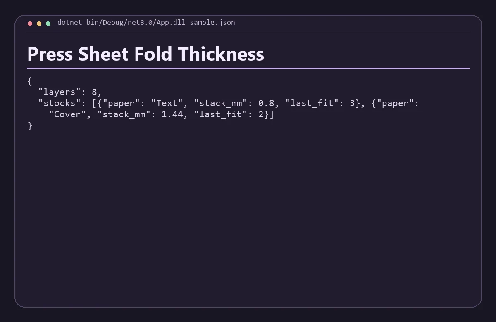

# Press Sheet Fold Thickness

Compare paper stocks for a folded insert, showing the growing layer count, estimated caliper and last fold that fits a clearance.



## Run

Install .NET 8 SDK and runtime. Run these commands from the repository root.

```sh
dotnet build --nologo
dotnet bin/Debug/net8.0/App.dll sample.json
```

Replace `sample.json` with a JSON file following the same structure. The app prints a JSON report to standard output.

Enter zero to twenty folds and paper caliper in micrometres. Each fold doubles the ideal layer count. last_fit considers the whole sheet through the requested fold count and is null if a single layer already exceeds the clearance. Compression, glue and bend radius are outside this geometric estimate.

## Verify

Run `python check.py` with Python 3.11 or newer after the build step when applicable. The check verifies the bundled scenario and confirms that an invalid input returns an error.
